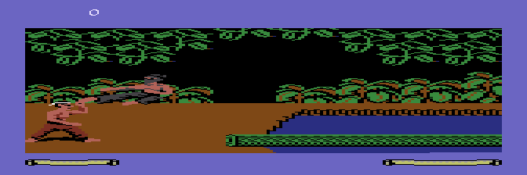
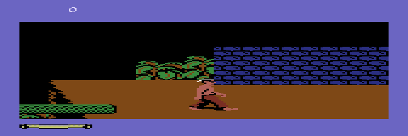

# Fist 2: The Legend Continues — Atari 8-bit VBXE Port

A port of the Adventure mode of the C64 game *Fist II: The Legend Continues* (Beam Software / Mindscape, 1986)
to the Atari 8-bit (65XE, NTSC, 64 KB RAM) — **built around the VideoBoard XE (VBXE)**.

## ⚠️ A VBXE is required

This port **will not work on a stock Atari**. The fighters are drawn by the VBXE blitter into an overlay bitmap,
and the whole picture uses the exact C64 colours through the VBXE palette. Without a VBXE the cartridge shows
the playfield but **no fighters**.

Needs: 65XE/XL with a VideoBoard XE (512 KB VRAM, FX core 1.2x) and a 2 MB MegaCart-compatible cartridge
(or a flash cart / emulator that supports it).

## Running it

The file is `Astra-vbxe-2026-10-29e.car` (2 MB MegaCart image). In Altirra / AltirraSDL, add the VBXE device:

    AltirraSDL --adddevice vbxe Astra-vbxe-2026-10-29e.car

or *System > Configure System > Peripherals > Add > Video Board XE*, then boot the cartridge image.

## What works (test cartridge 2026-10-29e)

* Title screen first; fire or START begins the game.
* Walking through the Adventure-mode playfield (ANTIC mode 4 with the game's own scrolling).
* Fighters drawn by the VBXE blitter with exact C64 sprite pixels at any X position, true C64 colours.
* First duel.

## Known limits

* Fighters update every 1–4 frames (about 2.5 on average), not every frame.
* Jaguars/tigers not yet checked.
* Playfield edge glitches while scrolling.
* Mid-sprite pointer changes are drawn at band level (a few pixels wrong on a piece's first row).
* No sound yet; it could be added later.
* Only tested in AltirraSDL; not tried on real hardware.

## Status

Work in progress; this repository currently holds only the playable test cartridge. Source code is not published here.

## Legal

*Fist II* is the property of its respective rights holders. This is an unofficial fan port and is not affiliated with them.
The cartridge contains game data derived from the original; you should own the original game.
